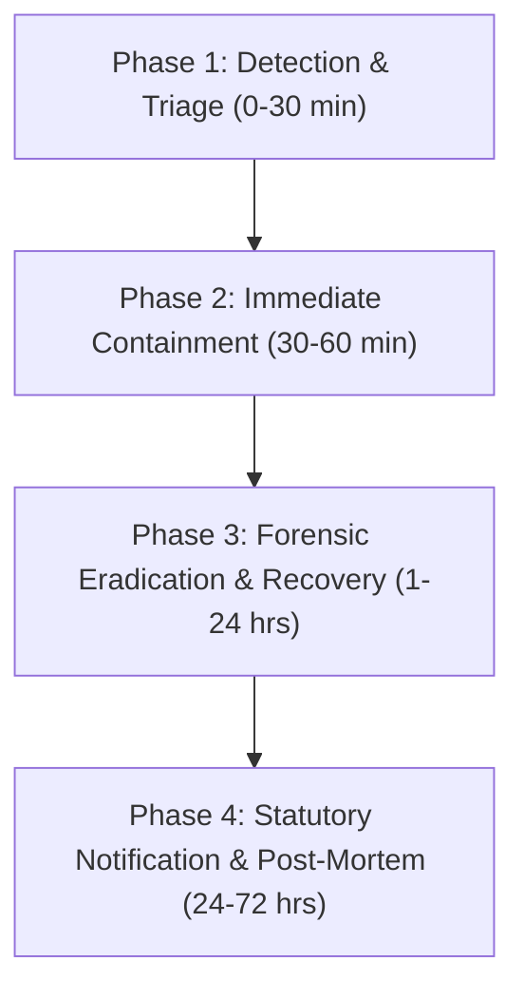

# VelourCare Ortho Cloud — Security Incident & Data Breach Response Plan
**Document Ref:** VC-SEC-002  
**Version:** 1.0.0 | **Effective Date:** November 2026

---

## 1. Objective & Scope
This plan defines the mandatory, time-critical procedures to detect, contain, investigate, and report any actual or suspected unauthorized access, exposure, alteration, or exfiltration of patient clinical records, 3D scans, or invoices within the VelourCare Ortho Cloud platform.

---

## 2. Incident Classification Matrix
| Level | Severity | Description | Response Time | Escalation Path |
|---|---|---|---|---|
| **P1** | **CRITICAL** | Confirmed unauthorized exfiltration or exposure of patient PHI/scans; unauthorized database access; ransomware; widespread IDOR exploitation. | **< 15 minutes** | Security Lead, CEO, Legal Counsel, DPO |
| **P2** | **HIGH** | Single user account compromise; brute-force surge causing service degradation; unauthorized role escalation attempt; credential exposure. | **< 1 hour** | Lead Engineer, Security Officer |
| **P3** | **MEDIUM** | Attempted SQLi/XSS blocked by filters; abnormal rate-limit trip; isolated upload filter rejection of malicious binary. | **< 4 hours** | Development Team |
| **P4** | **LOW** | Minor non-security exception, failed routine login. | Next business day | DevOps Review |

---

## 3. Four-Phase Incident Response Protocol

### Phase 1: Detection & Triage (0 to 30 Minutes)
1. **Report Ingestion:** Notifications arrive via automated error alerting, server health monitors, or user reports.
2. **Verification:** Validate anomalous activity against the immutable audit log (`/api/audit-logs`) and access logs.
3. **Classification:** Designate severity level (P1-P4) and assign Incident Commander.

### Phase 2: Immediate Containment (30 to 60 Minutes)
1. **Session Termination:** Invalidate all active tokens for affected user accounts immediately.
2. **Access Isolation:** Block offending IP addresses at firewall / reverse-proxy layer.
3. **Credential Rotation:** Rotate compromised API keys, database credentials, or server secrets immediately.
4. **Preserve Forensic Evidence:** Snapshot memory, copy server access logs, and freeze the audit log ledger without altering timestamps.

### Phase 3: Forensic Eradication & Recovery (1 to 24 Hours)
1. **Root Cause Analysis:** Identify the vulnerability vector (e.g., IDOR tampering, compromised credential, dependency flaw).
2. **Patch & Verify:** Apply hotfix in isolated test environment, execute security test suite (`tests/portal_security_qa_checklist_test.js`), and deploy to production.
3. **Integrity Validation:** Verify database state against the latest verified backup (`scripts/restore.js`).

### Phase 4: Statutory Notification & Post-Mortem (24 to 72 Hours)
1. **Regulatory Notification:**
   - **GDPR / EU Authorities:** Notify the relevant supervisory authority within **72 hours** of becoming aware of a high-risk personal data breach.
   - **HIPAA (HHS OCR):** For US patients, document and issue required breach notifications to affected individuals and HHS under 45 CFR § 164.400-414.
   - **UAE Health Authorities:** Submit formal incident filing to Dubai Healthcare City Authority / Department of Health as required by UAE Federal Law No. 2 of 2019.
2. **Affected Clinic Communication:** Provide clinic partners with affected case IDs, nature of exposure, remedial actions taken, and recommended patient disclosures.
3. **Post-Mortem Review:** Complete formal root-cause analysis (RCA) report and update security safeguards.

---

## 4. Emergency Incident Contact Directory
- **Chief Information Security Officer (CISO):** `security@velourcare.com` | +971 4 800 8356
- **Data Protection Officer (DPO):** `privacy@velourcare.com`
- **Legal Counsel:** `legal@velourcare.com`
- **Lead Infrastructure Engineer:** `ops@velourcare.com`
